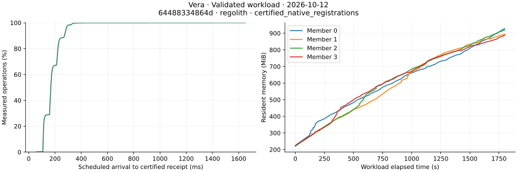

# Native candidate qualification on October 12, 2026

This is a historical source set. The [October 13 record](native-qualification-20261013.md)
contains the current compatible sources and focused qualification results.

These results exercise Vera with Regolith finalized history and Commonware QMDB
authenticated state. Candidate
[`6448833486`](https://github.com/sourcenetwork/vera.rs/commit/64488334864dd03033513df389b7fb03d348452d)
and merged main
[`8c061257a0`](https://github.com/sourcenetwork/vera.rs/commit/8c061257a0fad227c55ad15ae0c661e0f1942c35)
have the same complete source tree, `959b701c26d6529efbfd118e48397076cba2383f`.
The candidate includes Regolith's atomic compaction-manifest edits and batched WAL
recovery. The exact dependency revision is recorded in `Cargo.lock`.

## Growing registrations

[Run 38255256210](https://github.com/sourcenetwork/vera.rs/actions/runs/38255256210)
offered 90,000 distinct native registrations at 50/s for 30 minutes, with certified
permission checks. All 90,000 workflows completed in 1,800.222 seconds. Four
replicas agreed on every reconciled outcome, and hard-restart inspection found
zero receipt or state mismatches. The raw observations were checked locally with
the existing report loader and resource, I/O and worker summarizers; their
regenerated report exactly matches the hosted report.

| Measurement | Observed value |
| --- | ---: |
| Completed registrations/s | 49.994 |
| Scheduled arrival to certified receipt p50 / p95 / p99 | 167.91 / 283.76 / 329.12 ms |
| Permission read p50 / p95 / p99 | 2.78 / 9.63 / 15.53 ms |
| Not sent, unknown, rejected, reverted or incomplete workflows | 0 |
| Verification failures and restart receipt/state mismatches | 0 |
| Restart to RPC readiness / observed probe | 15.37 / 15.41 s |

All four validators and the client ran on one Ubuntu 24.04 hosted machine with
four logical CPUs, an Intel Xeon Platinum 8573C and about 16 GB RAM. The normal
release daemon used a 100 ms proposal batch wait and 50 ms receipt polling.
Heap and syscall tracing were disabled; one-second resource sampling and periodic
numeric resource diagnostics were enabled. Recorded host load averages were
2.83 before and 13.46 after the run; this is not an isolated-host speed comparison.

| Validator | Peak sampled RSS | Mean sampled CPU use | RSS growth in last ten minutes |
| --- | ---: | ---: | ---: |
| 0 | 927.39 MiB | 0.428 cores | 214.24 MiB |
| 1 | 893.34 MiB | 0.389 cores | 141.04 MiB |
| 2 | 920.27 MiB | 0.389 cores | 171.91 MiB |
| 3 | 889.50 MiB | 0.395 cores | 137.30 MiB |

Each validator has 1,801 resource samples, with no missing members. Memory was
still growing with the dataset. Linux status samples show 666.46–701.93 MiB of
anonymous RSS growth, while file-backed RSS grew only 1.00–1.25 MiB. Anonymous
memory includes live state, heap caches and allocator retention; these counters
do not identify component ownership or establish a leak.

This run establishes the recorded 50/s workload,
not maximum capacity, a steady-state memory ceiling or WAN behavior. Receipt
latency includes scheduled-arrival delay, submission, polling and verification;
it is not consensus-only finality latency. The earlier
[Go/Rust comparison](performance-20261011.md#matched-gorust-registrations) remains
a separate measurement with its own source and configuration.

## Executable provenance and clean builds

The measured daemon SHA-256 is
`24bf7e586718e5f2bdcdd58399baa016bf936983d1953f6ebc4d47059c44a8f3`.
It equals both independently compiled normal release binaries from
[run 38254896286](https://github.com/sourcenetwork/vera.rs/actions/runs/38254896286).
Both downloaded archives also match, with SHA-256
`3584ed83d07a1cc169d869e15006d9ba5d9e9a8193e56c2f44130b5effe439cf`.
The existing release comparer independently checked the downloaded archives and
reproduced the hosted comparison record. This proves equality for the recorded
Ubuntu 24.04/Rust 1.98.0 build environments and source path, not across arbitrary
toolchains or platforms.

The workload artifact contains the manifest, all observations, numeric diagnostics,
report and standalone interactive replay. Manifest SHA-256 is
`d8d3234de318f95eefe8e320564a11e3936ff7612fd74b49bfda1a406a0f72d8`;
workload JSONL SHA-256 is
`4d5d1df3ec01b63472fecf204804ac69e8d8eb94ec999c4c3cb781a37bee00ca`.

## Recovery checks

[Merged-main CI 38259396771](https://github.com/sourcenetwork/vera.rs/actions/runs/38259396771)
passed all twelve executed jobs, including both end-to-end suites, all recovery
jobs, Linux checks and release artifact packaging. Its lifecycle evidence records
successful stopped-backup restoration, native and pipelined member joins, and
pipelined quorum recovery across epochs. The stopped-backup case copies and
restores the complete stopped directory, checks validator key, epoch-share and
genesis bytes, catches up revoked permissions and receipts, and requires the
restored member's participation in a later quorum.

These checks qualify their named process-recovery scenarios. They do not prove
device power-loss durability, hostile local-signer rollback protection or explain
the earlier two-hour workload's readiness timeout. Final consumer, threshold
soak/fault qualification and the remaining operating-limit checks must retain
their own source-bound evidence.

Merged-main unit results also record successful WebSocket dispatch backpressure,
shutdown with a non-reading client, and release of that client's connection slot
after the writer timeout. The server limits each connection's queued messages and
active request tasks; batches execute sequentially under an aggregate response
budget. These checks cover the implemented slow-client behavior, not aggregate
RSS at the maximum connection and payload limits or slow-validator/WAN behavior.

## Admission pressure

The four-member pressure fixture admits 4,096 signed namespace registrations
without quorum and checks that three submissions of the next exact signed request
are rejected without consuming its sequence. It restores quorum, waits for the
backlog and the same rejected request to finalize, then checks all 4,097 records,
owners, sequences and the retry receipt on every member using certified reads.
Each phase has a 120-second deadline; this is a recovery check, not a throughput
measurement.

[Run 38284119585](https://github.com/sourcenetwork/vera.rs/actions/runs/38284119585)
passed the complete scenario at fixture `af24c6a2c5`: one executed case, zero
failures or ignored cases, and command exit status zero. The retained source is
the synthetic PR merge `1af8a4dc30`, whose tree exactly matches that fixture.
This qualifies the named normal-release saturation, recovery and reconciliation
case, without changing production code or dependencies.

[Debug run 38277526491](https://github.com/sourcenetwork/vera.rs/actions/runs/38277526491)
timed out recovering the backlog. The normal
[release run 38280881159](https://github.com/sourcenetwork/vera.rs/actions/runs/38280881159)
at fixture `17f9914d84` recovered the backlog, finalized the retried request and
restarted the fourth member, then failed during certified namespace pagination.
Its retained evidence does not identify the read error. Those earlier failures'
causes remain unproven; the later pass does not establish their causes.

The fixture retries only explicitly retryable busy responses during pagination,
preserving the cursor and minimum revision within the original overall deadline.
Other read errors fail immediately and export only a static error class and
replica index. Receipt reconciliation also waits for evidence that is not yet
available, within that same deadline. Compilation has a separate CI step from
the bounded test run.

## Threshold lifecycle and consumer storage

[Run 38259512483](https://github.com/sourcenetwork/orbis-rs/actions/runs/38259512483)
passed all nine named final threshold cases. BLS12-381 and Jubjub each passed
distributed signing, PET workflows, member replacement and scheduled refresh
after restart. BLS also passed the Defra-signing fixture. The downloaded completion
records were checked for the exact expected cases, successful status and positive
duration. Both curves used normal Orbis runtime `20dfa47`, native SDK `9d5c2b9`
and the final Vera daemon `6448833486`. These focused passes do not qualify every
consumer operation or prolonged load.

[Soak run 38263012953](https://github.com/sourcenetwork/orbis-rs/actions/runs/38263012953)
also passed with normal runtime images. Each cycle checked revocation and regrant,
concurrent PRE recovery and independently verified derived-key signing. All members
were restarted twice during the interval and once afterward, preserving identities
and encrypted stores. The measured interval includes restart downtime.

| Curve | Completed cycles | Measured interval | Group restarts |
| --- | ---: | ---: | ---: |
| BLS12-381 | 460 | 901 s | 3 |
| Jubjub | 446 | 901 s | 3 |

Downloaded records passed the exact-case, minimum-cycle, duration and restart
checks. [Fault-report run 38266090299](https://github.com/sourcenetwork/orbis-rs/actions/runs/38266090299)
passed its named PET fault-report case on both curves using labelled diagnostic
images. These protocol fault cases do not qualify storage power loss or hostile
local-signer rollback. Both runs retain their actual fixture revisions; the
normal runtime and Vera daemon pins are unchanged.

[CI 38263020507](https://github.com/sourcenetwork/orbis-rs/actions/runs/38263020507)
also passed all six pending-share startup reconciliation cases on each curve.
They cover matching, nonmatching and unfinalized records, absent pending state,
and PET-only recovery after the main pending record has already been cleared.
The existing named results were checked in both unit-job logs. This qualifies
that process-interruption recovery logic; it does not authenticate a restored
copy of the entire encrypted store or prove hostile rollback protection.

The frozen
[Defra revision](https://github.com/sourcenetwork/defradb.rs/tree/8cfd791fe7f3b69777c60b436f6b32c1a4447526)
uses Regolith `8f462e8370a670f923eefde562f83de1c42a55ef`, a backport containing
the atomic manifest and batched WAL-recovery fixes. Its required atomic-batch
persistence/failure path, regression tests and WAL-recovery implementation were
compared against Vera's Regolith pin. Newer main also changes level ordering and
orphan sweeping, so the complete stores are not identical and this is not a
backend performance comparison. The durability backport does not require a
consumer dependency bump. The final gateway checks below qualify the selected
immutable source set for their named workflows.

Defra's lockfile selects Backbone's `acp-light-client` at
[`7d67ddbb`](https://github.com/sourcenetwork/backbone/tree/7d67ddbbb0d3d671b95dfe322b920e2e943c1daa),
rather than selecting Backbone main. Its client source tree, crate manifest and
workspace manifest match the existing approved candidate `0a383a36`. This records
the actual dependency used by the frozen build; source equality does not replace
dependency-closure or final integration checks.

## Native gateway recovery

[Run 38260732258](https://github.com/sourcenetwork/trust-api/actions/runs/38260732258)
passed executable and container recovery for the final Trust candidate `4b58e16`.
Both use the final Vera daemon/shared verifier and frozen Rust Defra source set.
The scenario exercises four Vera members and the shared Rust document store,
including provider authentication, policy/object operations, retained outcomes,
restart and relay revocation. The container runs as its normal image user.
[Final ring run 38260732413](https://github.com/sourcenetwork/trust-api/actions/runs/38260732413)
passed all four executable/container contracts across BLS12-381 and Jubjub. Each
curve reports two real Go test executions, six production-KDF stores and sixteen
checked ring records. The source sets and actual gateway, verifier and Vera image
binary hashes match across curves. The Trust PR merge checkout's complete tree
equals candidate `4b58e16`; daemon `6448833486`, SDK `9d5c2b9`, normal Orbis
`20dfa47` and Rust Defra `8cfd791` are bound independently. These named workflows
do not establish every gateway route, WAN behavior or an operating resource limit.
