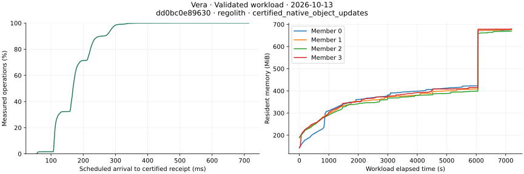
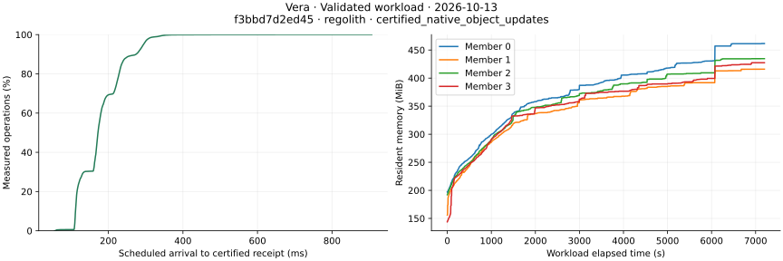

# Native qualification on October 13, 2026

The recorded native stack passed the gateway, threshold and process-recovery
checks below. Vera uses pipelined Simplex, operator-managed membership, Commonware
QMDB authenticated state and Regolith finalized history. Trust remains a separate
Go gateway; Orbis remains a separate Rust threshold service. These results cover
the recorded sources and scenarios. Resource bounds and multi-host qualification
remain open.

## Consumer checkpoint sources

The consumer results in this table retain their tested source set. The newer
Vera storage build is qualified separately below; those measurements do not
refresh the earlier consumer tests.

| Component | Revision | Role |
| --- | --- | --- |
| Vera | `0c26e9e568c179790cc2f3eb9e48849b08e6173f` | Daemon and shared verifier |
| Vera runtime merge | `112a1df99dbf23915c5764e540d495d63c7eacab` | Same complete tree as the tested candidate |
| Trust API | `52f66e6d4b7ccdd3c3446aa91b9a147f531527bc` | Executable and container gateway |
| Orbis normal runtime | `20dfa47de9ad5ae5fe4c7748089dea5be286b556` | BLS12-381 and Jubjub threshold services |
| Orbis qualification fixture | `c638455a5d43e5e31aeac41427a69ed18733f705` | Native integration driver |
| Vera SDK used by consumers | `9d5c2b9ea7cb971a7871028b7b0b22d488a7ecbf` | Native client and verifier source |
| Defra | `8cfd791fe7f3b69777c60b436f6b32c1a4447526` | Native provider and document store |
| Backbone SDK selected by Defra | `7d67ddbbb0d3d671b95dfe322b920e2e943c1daa` | Approved native proof client |

Vera's candidate and merge have tree
`45049623e125e77e509460753d9595789bdf055f`. The actual Trust PR merge used by the
jobs, `bd1f4933fbaecfcb542550293c91410da5805f87`, has the same complete tree as
the listed Trust candidate. The Orbis driver checks the normal runtime's source
boundary before reusing its images. Fixture revisions do not imply a runtime
upgrade. The Backbone client source matches its approved candidate; Defra's
lockfile selects the SDK revision in the table.

The measured cohort pins Rust 1.98.0, Regolith 0.1.9 at
`061846fc870389391f77b8c2a3cf370b6e69d95f` and Commonware 2026.9.0 at
`0ebcf164594621f2c82769eef7e9f3a21153055f`. Consumer stores retain their tested
pins; they are not assumed to be identical to Vera's history store.

## Verified consumer results

- [Gateway recovery, run 38384932545](https://github.com/sourcenetwork/trust-api/actions/runs/38384932545):
  executable and container modes each passed initial operation, restart/outcome
  recovery, and relay-revocation/restart phases. Four Go root cases per phase
  produced 24 passing case instances. Both modes use four Vera validators and
  Rust Defra, with independently provisioned consensus trust.
- [Real ring consumers, run 38384932362](https://github.com/sourcenetwork/trust-api/actions/runs/38384932362):
  BLS12-381 and Jubjub each passed executable and container contracts. Each curve
  checked six production-KDF stores, two Go contracts and sixteen ring records.
  Both curves used identical Vera, gateway and verifier executables and identical
  private Vera/gateway images. The normal Orbis image differs by curve.
- [Threshold lifecycle, run 38377014040](https://github.com/sourcenetwork/orbis-rs/actions/runs/38377014040):
  nine selected cases passed. Both curves covered distributed signing, PET,
  member replacement and scheduled refresh after restart; BLS also covered
  Defra signing.

Downloaded completion records, archive checksums and source bindings were checked
for these runs. The gateway runtime archive's six transferred binaries were also
hashed independently. Host and container gateway builds use separate recipes;
their binary equality is not assumed.

Earlier Defra document/replication, Backbone consumer, threshold churn and soak
checks retain their own source and scenario boundaries in the
[October 11](native-qualification-20261011.md) and
[October 12](native-qualification-20261012.md) records. The final focused checks
above do not turn every earlier workflow into a newly executed test.

## Native delegation and membership

[Linux lifecycle job 115540848468](https://github.com/sourcenetwork/vera.rs/actions/runs/38468384239/job/115540848468)
passed both native delegation cases with pipelined Simplex. Independent workers
concurrently created distinct policies for one actor; certified results preserved
actor ownership, worker identity and submission attribution. Wrong-worker and
wrong-scope requests failed, and revoked bearer tokens and relay grants remained
invalid after restart. The lifecycle job now explicitly selects these tests.

The same captured results include pipelined member admission without bootstrap
shares, interrupted admission, cold replay and quorum recovery. Existing unit
cases cover operator quorum and rotation, invalid approvals, consensus-key
validation, full-width member indices and membership capacity. These are named
conformance checks, rather than a formal proof for every deployment condition.

The delegation job tested `99f81ba1d9b3b96785cab04df6d58c3a51d1cbb9` through merge
`a69d490498756931e7f20b4d5b7ce2e2a3ab509c`; their complete trees match. Its changes
from the storage build below affect tests, measurement tools and documentation;
production Rust and locked dependencies are unchanged.

## Final native consumer source set

The completed final gateway and ring jobs selected this newer version set:

| Component | Revision |
| --- | --- |
| Vera daemon | `f3bbd7d2ed4559c43dab9e171d1bf70b0e639c64` |
| Vera merge with identical tree | `5ec845b42e5e168ef644572552d97afafa431b1d` |
| Trust candidate | `c312706acddd824286926ccbe0db118e0566968f` |
| Trust tested merge with identical tree | `f0324145b8775003aaa2a56830510bcd99c46b39` |
| Orbis native fixture | `c7bad73c28f3197ba032affb25e3007ee421aaaf` |
| Orbis normal runtime | `9ebdeda8f475e917fd26fdfe37517497842f7040` |
| Orbis image build with identical runtime tree | `bae0b000aa9f734ac878d92b5ff8b70a76bd67a0` |
| Native SDK/verifier | `9d5c2b9ea7cb971a7871028b7b0b22d488a7ecbf` |
| Defra | `8cfd791fe7f3b69777c60b436f6b32c1a4447526` |
| Backbone SDK selected by Defra | `7d67ddbbb0d3d671b95dfe322b920e2e943c1daa` |

[Gateway recovery 38449320832](https://github.com/sourcenetwork/trust-api/actions/runs/38449320832)
passed both executable and container modes: initial operation, restart with original
outcomes, and relay revocation followed by restart. All 24 Go root-case instances
passed. The official ZIP checksum, inner archive checksum and all six transferred
binary hashes were checked independently, together with the exact tested tree.

[Real ring consumers 38449320988](https://github.com/sourcenetwork/trust-api/actions/runs/38449320988)
passed four executable/container contracts across BLS12-381 and Jubjub. Each curve
checked six production-KDF stores, two Go contracts and sixteen ring records.
The official result and runtime archive checksums, five transferred host files,
private image archives and shared source/binary/image bindings were verified.
Both captured normal Orbis image IDs match their independently verified OCI
configurations and source labels. Host and container builds retain their distinct
recipes; binary equality between them is not assumed.

[Current native Orbis suites 38449313428](https://github.com/sourcenetwork/orbis-rs/actions/runs/38449313428)
passed 22 BLS and 21 Jubjub tests, including seventeen functional case instances
covering distributed signing, encryption/PRE, PET, permission revocation, identity
restart, required incoming-member shares and scheduled refresh after restart.
Three skipped cases per curve remain unqualified. These jobs use Vera's pinned
final storage source. They do not establish prolonged current-source membership
soak, capacity or WAN behavior.

Earlier complete document/replication and threshold churn/soak checkpoints keep
their recorded sources and scenarios. The focused final jobs above do not convert
every historical test into a new execution of the entire product suite.

## Release and recovery evidence

[Merged-main CI 38382288298](https://github.com/sourcenetwork/vera.rs/actions/runs/38382288298)
passed all twelve executed checks, including Linux lifecycle, snapshot recovery,
disk-full, sync-failure, commit-crash and release packaging. These qualify their
named process and injected-storage-failure cases, rather than physical device
power loss or hostile restoration of signing state.

[Two clean builds, run 38376496879](https://github.com/sourcenetwork/vera.rs/actions/runs/38376496879)
produced identical normal Linux release executables with SHA-256
`35cfca781a1dce16a2733bd4aeecdcbc120a124753d20f34692ccd72b37db0a7`.
Downloaded archives and the regenerated comparison matched. This establishes
reproducibility for the recorded Ubuntu 24.04/Rust 1.98.0 environments.

The storage candidate `f3bbd7d2ed4559c43dab9e171d1bf70b0e639c64` also passed
[two independent clean builds, run 38443055980](https://github.com/sourcenetwork/vera.rs/actions/runs/38443055980).
Both used absent target directories, the same recorded Ubuntu 24.04/Rust 1.98.0
environment and normal release features. Their executable SHA-256 is
`a5349a3a3ad03f664dd5a9aae7b2556e7edf5203e43cddc6aef9d52824fd71f2`; their
release archive SHA-256 is
`72916aa6be2ac38bbd3db0cd778ac19fbfc2a335de41327372e19f8679191aaf`.
The downloaded artifact checksums, canonical archive members, source, lockfile,
compiler and build environment were checked independently, and the comparison
regenerated exactly. Runtime measurements below retain their own source and
executable hashes; build equality alone does not qualify memory or recovery.

[Candidate CI 38431160438](https://github.com/sourcenetwork/vera.rs/actions/runs/38431160438)
passed all eleven executed core checks. Its unit log contains all 110 selected
native conformance cases and the required rejection, reverted-command replay and
competing-fork cases. The captured lifecycle results include signed substitution
and worker deduplication, grant/denial reads, archive/regrant and real member joins
without a bootstrap share across restarts. The tested merge tree exactly matches
the frozen candidate. These qualify named scenarios, rather than exhaustive error
permutations or every deployment condition.

The native runtime dependency review at RustSec database revision
`d5f46becf4d442d460e1fce5e12f2c0f00924868` found no vulnerability, unsoundness or
yanked-package findings in the selected Linux runtime graph, excluding development
dependencies. Maintenance notices for `derivative`, `paste` and `unsafe-libyaml`
remain unsuppressed. Parser input limits do not establish `unsafe-libyaml` memory
safety. This review is a dependency check, not a complete security proof.

## Measured operating behavior

[Run 38376511669](https://github.com/sourcenetwork/vera.rs/actions/runs/38376511669)
completed 90,000 fixed-object updates at 49.998/s over 30 minutes, with one verified
permission read per write. Certified receipt p95 was 276.88 ms; permission-read
p95 was 8.73 ms. All four replicas reconciled, the restarted member retained the
inspected receipts and state, and all four read throttles recovered.

[Allocator comparison 38386604388](https://github.com/sourcenetwork/vera.rs/actions/runs/38386604388)
completed two further 90,000-update runs with the same normal binaries, one hosted
machine and 128 fixed objects. Both passed replica and restart checks with zero
mismatches. Per-revision span-close tracing was disabled; periodic numeric
diagnostics and one-second resource sampling remained enabled.

| Measurement | Default glibc arenas | Two glibc arenas |
| --- | ---: | ---: |
| Completed updates/s | 49.997 | 49.997 |
| Certified receipt p95 | 611.77 ms | 592.91 ms |
| Verified permission-read p95 | 16.12 ms | 15.80 ms |
| Last/peak sampled RSS per validator | 441.21–473.38 MiB | 336.65–352.65 MiB |
| RSS growth during the last ten minutes | 51.32–78.19 MiB | 33.43–41.84 MiB |

Average final RSS was 24.0% lower with two arenas in this single sequential pair.
Both cases were still growing. The production allocator remains unchanged. The
AMD EPYC host and recorded load differ from the earlier Xeon run despite identical
daemon bytes; the latency difference does not establish a source regression or
its cause. Both downloaded reports regenerated exactly from the raw observations.

These runs establish completed work at the offered 50/s load on one four-CPU
Ubuntu host. They do not establish maximum capacity, a 300 ms latency guarantee,
a memory ceiling or WAN performance. Receipt latency includes scheduling,
submission, polling and verification. The
[Go/Rust comparison](performance-20261011.md#matched-gorust-registrations) remains
a separate deployment comparison with its own sources and settings.

### Two-hour fixed-state run

[Extended run 38402671704](https://github.com/sourcenetwork/vera.rs/actions/runs/38402671704)
completed all 360,000 updates and verified permission reads over two hours at
49.999 updates/s. All four replicas reconciled; the restart inspection checked
360,000 operations with zero receipt or state mismatches. Two receipt-read
throttles recovered. There were no rejected, reverted, unresolved or incomplete
workflows. Restart RPC readiness took 3.51 seconds.

| Measurement | Observed result |
| --- | ---: |
| Certified receipt p50 / p95 / p99 | 168.19 / 286.00 / 310.95 ms |
| Verified permission-read p50 / p95 / p99 | 3.10 / 11.01 / 16.64 ms |
| Peak sampled RSS per validator | 669.62–679.10 MiB |
| Average CPU per validator | 0.40–0.44 cores |
| RSS change during the last ten minutes | -0.05 to +6.31 MiB |
| RSS change during the last thirty minutes | +263.07 to +274.70 MiB |

The run used 128 fixed objects, four local validators, a 100 ms batch interval,
192-revision epochs and two controlled glibc 2.39 arenas on one four-CPU AMD EPYC
7763 Ubuntu host. Source `dd0bc0e89630e128053b192a532f886bf74a9592` produced the same
normal daemon SHA-256 `35cfca781a1dce16a2733bd4aeecdcbc120a124753d20f34692ccd72b37db0a7`
as the earlier clean-build pair in run 38376496879. Per-revision span-close tracing
was disabled; numeric diagnostics and one-second sampling remained enabled.
All 7,201 resource samples per validator were present. The artifact checksum
matched GitHub's digest and the numeric report regenerated exactly from raw
observations. These are offered-load results, rather than a maximum-capacity
measurement or a 300 ms guarantee.

The synchronized RSS jump coincides with the first Regolith compaction after the
fourth memtable flush. Between recording seconds 6,330 and 6,360, each validator's
compaction-output counter increased from zero to 116,683,074 bytes, while free
glibc arena memory increased by 252–258 MiB. Live allocator usage and directly
mapped memory did not show the same jump. The selected Regolith source scans
compaction inputs through the shared read cache and evicts those inputs after
publication. This establishes cache pollution in that implementation; the
30-second diagnostic interval does not capture its transient peak or attribute
the entire RSS jump to one owner.

The slower final ten minutes do not prove a memory plateau. The thirty-minute
window includes the compaction jump, and the complete run covers only one
observed compaction episode. A successful restart also does not explain older timeouts.

### Compaction cache boundary

Vera now selects Regolith revision `f6958cf0cea97f658dbdbc3572063a8122645101`.
Compaction scans use a zero-capacity cache instead of populating the foreground
read cache with input blocks that become obsolete when the merge completes.
Foreground reads retain their configured cache; obsolete-file eviction still
targets that shared cache. The default history cache budget and allocator are
unchanged. Partitioned-index scans also bypass metadata caching during the merge,
which can increase metadata reads. Checksums, version reduction and durable
publication retain their existing paths.

The Regolith candidate's Linux workspace run passed all 1,810 selected tests,
including the cache-inspection fixture. That fixture checks the cache during
compaction, before eviction can hide pollution, and verifies all 256 output
key/value pairs for flat and partitioned indexes with uncompressed and LZ4 data.
The Linux CI profile has no default test filter; successful individual case lines
are suppressed in its log. The selected revision also passed strict lint, MSRV,
allocation budgets and modeled durability checks. These results establish the
tested cache and storage boundary. The preceding two-hour numbers retain their
older Regolith revision; the follow-up below measures the new implementation.

### Two-hour compaction follow-up

[Run 38431246384](https://github.com/sourcenetwork/vera.rs/actions/runs/38431246384)
completed all 360,000 updates and verified permission reads at 49.999 updates/s.
All four replicas reconciled, and restart inspection checked all 360,000
operations with zero receipt or state mismatches. The recorded normal release
executable matches the independently reproduced `a5349a3a…` hash above.

| Measurement | Earlier scan cache | Foreground cache bypass |
| --- | ---: | ---: |
| Completed updates/s | 49.999 | 49.999 |
| Certified receipt p50 / p95 / p99 | 168.19 / 286.00 / 310.95 ms | 172.05 / 294.07 / 331.43 ms |
| Verified permission-read p50 / p95 / p99 | 3.10 / 11.01 / 16.64 ms | 3.93 / 12.95 / 19.22 ms |
| Peak sampled RSS per validator | 669.62–679.10 MiB | 415.91–461.62 MiB |
| Average CPU per validator | 0.40–0.44 cores | 0.43–0.46 cores |
| RSS change during the last ten minutes | -0.05 to +6.31 MiB | +0.26 to +3.66 MiB |
| RSS change during the last thirty minutes | +263.07 to +274.70 MiB | +24.58 to +34.82 MiB |
| Free glibc arena increase across first compaction | 251.75–258.42 MiB | 20.62–34.34 MiB |
| Restart RPC readiness | 3.51 s | 4.38 s |

Mean final RSS was 35.6% lower in this measured pair. Both runs use the same
workload, topology, allocator selection, pruning, epoch and proposal settings;
only setup time differs in their recorded configurations. The hosted CPU models
also differ: the baseline used an AMD EPYC 7763, while the follow-up used an EPYC
9V74. Both expose four logical CPUs. This is one observed pair, without a
statistical or controlled-hardware performance claim; the latency values do not
establish a source regression or improvement.

Each follow-up member completed its first compaction, recording 116,579,580 output
bytes. The much smaller free-arena increase is consistent with avoiding input
blocks in the foreground cache. Thirty-second diagnostics do not capture transient
peaks or uniquely attribute the complete RSS change. The history-write admission
stall counter remained zero in both runs; it does not measure every storage wait.

The frozen source is `f3bbd7d2ed4559c43dab9e171d1bf70b0e639c64`; merged main
`5ec845b42e5e168ef644572552d97afafa431b1d` has the same complete tree. The official
artifact ZIP SHA-256 is
`3ae1dbf07853a800226cd199011470e56373ca6dc351fe6f16c70ec731af1705`.
The checksum matched, all 7,201 resource samples per validator were present, and
the numerical report regenerated exactly from raw observations. Per-revision
span-close tracing was disabled; periodic numeric diagnostics and one-second
sampling remained enabled. The chart is copied from that verified artifact.

The final ten minutes are relatively flat, but the final thirty-minute and
hour-long windows still grew. One observed compaction does not establish a hard
memory ceiling or a steady-state plateau. Fixed object count also does not keep
finalized history size fixed. These results qualify the offered 50/s workload,
its lower observed memory use and recovery, rather than maximum capacity, WAN
performance or a 300 ms guarantee.

## Remaining qualification

Establish a steady-state resource envelope and document growing-data sizing.
Historical readiness and DKG deadlines remain causally unexplained; later passes
do not explain them. Multi-host/WAN qualification awaits test hosts. Preserve
these limits when selecting deployment budgets or describing release readiness.
See [operations](operating.md), [certified readiness](readiness.md),
[history recovery](history-storage.md) and [key boundaries](native-pet.md#deployment-boundary)
for the implemented operating requirements.
