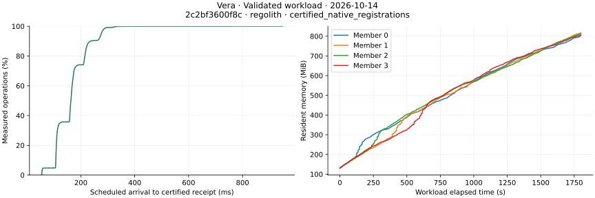

# Native workload measurements on October 14, 2026

Four local Vera validators completed the growing-state and admission-recovery
workloads below using pipelined Simplex, operator-managed membership, Commonware
QMDB state and Regolith finalized history. These are measured offered-load and
recovery results. They do not establish maximum capacity, a memory plateau or
multi-host latency.

## Growing state

[Run 38503258544](https://github.com/sourcenetwork/vera.rs/actions/runs/38503258544)
offered 90,000 distinct ACP object registrations at 50/s over thirty minutes.
Each operation used a distinct signer and included one verified permission read.
All operations completed, all four replicas agreed, and hard-restart inspection
found no state or receipt mismatch. There were no rejected, reverted, unsent,
unknown or verification-failed operations, and no client or server throttles.

The validators and client shared one hosted Linux machine with four logical CPUs,
an Intel Xeon Platinum 8573C and 16,765,378,560 bytes of physical memory. The clean
source and runner revision was `2c2bf3600f8c81e51c258bb16b63587bed8b5f59`.
The build used Rust 1.98.0, the normal release profile, Commonware revision
`4f5db3d0dc30900015fb13347e9ec20ae085b79a` and Regolith revision
`f6958cf0cea97f658dbdbc3572063a8122645101`.

| Measurement | Result |
| --- | ---: |
| Confirmed registrations / completed workflows | 90,000 / 90,000 |
| Confirmed registrations/s | 49.996 |
| Scheduled arrival to certified receipt p50 / p95 / p99 | 162.980 / 275.807 / 292.985 ms |
| Verified permission read p50 / p95 / p99 | 2.230 / 7.702 / 12.683 ms |
| Scheduled arrival to completed workflow p95 | 280.265 ms |
| Restart to RPC readiness / observed certified probe | 9.783 / 9.842 s |
| First sampled RSS per validator | 129.71–131.89 MiB |
| Last and peak sampled RSS per validator | 802.67–816.31 MiB |
| RSS growth during the last ten minutes | 154.31–182.30 MiB |
| Average CPU cores used per validator | 0.346–0.369 |
| Retained allocated files after the workload | 323.89–324.74 MiB per validator |

The chart is copied from the run's artifact. Its latency distribution contains
all 90,000 certified outcomes; each memory curve contains 1,801 one-second samples
with no missing members. The source and runner were clean. Per-revision tracing
was disabled; numeric resource diagnostics ran every thirty seconds. The allocator
was glibc 2.39 with no arena override. These results do not measure zero-overhead
execution or a controlled improvement over a different host or allocator setting.

The workload used a 100 ms proposal batch wait, at most 256 operations and 16 MiB
of encoded operation bytes per revision, 192 revisions per epoch and Simplex
terms of sixteen views with four optimistic views. This growing-state run differs
from the earlier fixed-object updates: both live objects and worker records grow.

### Observed memory components

The workload clock anchor identifies sixty in-workload numeric snapshots for each
original validator process. Near the end of the timed workload, sampled history
block-cache use was 0.03–2.34 MiB and memtables were approximately 38.08 MiB.
The cached revision index and finalization-proof counts were both 1,024;
the epoch-proof count was 78. Regolith's admitted-write stall counter did not
increase between the first and last of these snapshots.

glibc reported 451.31–459.45 MiB in arena allocations, 119.57–122.68 MiB in direct
mapped allocations and 200.15–237.70 MiB free inside its retained arenas. Those
scopes overlap the storage and application measurements; they cannot be added
together as independent parts of RSS. They also do not identify every allocation
owner or prove a leak. Continued late RSS growth means a stable resource envelope
remains unqualified. Reducing the history block-cache budget alone does not
explain the observed memory use in this run.

The last in-workload snapshot also recorded 179,498 ACP index keys and 89,747
worker-sequence index keys on every validator. These grow with registered objects
and distinct signers; the matching item/key counts show no translated-key
overflow entries in those native indexes at that sample. Each translated native
index key occupies 256 bytes, so the four native indexes' key payload alone
accounts for approximately 65.73 MiB per validator. This calculated payload
excludes tree slots, metadata, indexed values and the in-memory module records;
it is neither an RSS total nor proof that all remaining growth is necessary.

### Artifact provenance

The official artifact is
`performance-regolith-2c2bf3600f8c81e51c258bb16b63587bed8b5f59`, ID
`11868024251`, with ZIP SHA-256
`fba5c3137978d3aecc777e604628e582240e55afd1907912b60148d46f6c5f0b`.
The manifest, raw operation outcomes, replica and restart records, resource
samples and numeric diagnostic timestamps were checked. Receipt percentiles were
regenerated from the raw observations.

The tested daemon SHA-256 is
`8a2de2dae0954b1dd87f270cf0303092805ee24a642f5eb3113a949a1e1ec5b5`;
the workload runner SHA-256 is
`0b82010a60b536f16e8970e0085e5a238fd47cacf93b54d71e3db3b946605ab3`.
The retained chart SHA-256 is
`517dd9da46dd6a4a8676400d6938cfc8ee4734ad23e0364b579143a2fbb64e1b`.
The artifact also contains an interactive replay of the collected measurements.

## Native consumer checks

The following completed checks use a frozen Vera runtime revision,
`e48e1d8f9f701da94554a176d913131e2e6a5277`. They retain their own executable and
container build recipes; the workload hashes above are not substituted for
consumer binaries.

| Component | Tested source | Native SDK source |
| --- | --- | --- |
| Defra provider/document fixture | `87a10b380446303e20587a6c48e05ec31f9695f0` | `1dab0c4562da551b1a7f00fcea643b914769891c` |
| Go Trust gateway and ring fixture | `3003e203e5dc5c8e79d09fb012c616b278bc896c` | `9d5c2b9ea7cb971a7871028b7b0b22d488a7ecbf` |
| Orbis native fixture | `a0557e7018e98e2d680eb48c8a8844764ec84b93` | `9d5c2b9ea7cb971a7871028b7b0b22d488a7ecbf` |

- [Defra consumer run 38504424615](https://github.com/sourcenetwork/defradb.rs/actions/runs/38504424615)
  passed fourteen provider cases and seven live document, access, revocation,
  replication and restart cases. The actual PR merge
  `040af3db9a1389e49bfb6945fb8fa18143eeac5a` matches the listed candidate tree.
  The driver checks exact named test selections, source and lockfile continuity,
  and staged executable digests before and after each phase. The public artifact
  exports numeric outcomes and revisions; private raw logs and executable digests
  are not included for independent rehashing.
- [Trust gateway run 38498175727](https://github.com/sourcenetwork/trust-api/actions/runs/38498175727)
  passed executable and container modes through initial operation, restart/outcome
  recovery and relay revocation followed by restart: twenty-four Go root-case
  instances. Its transferred runtime archive and all six binaries were hashed
  independently. The actual merge
  `a6d8393a9c7185996b9b635caaa074479d51835d` matches the listed Trust candidate tree.
- [Trust ring run 38498175658](https://github.com/sourcenetwork/trust-api/actions/runs/38498175658)
  passed executable and container contracts on both BLS12-381 and Jubjub. Each
  curve checked six production-KDF stores, two Go contracts and sixteen ring
  records. Official result ZIP checksums and their source/image bindings were
  verified. The executed driver checks transferred binary and image digests;
  independent rehashing of this run's larger runtime package is separate.
- [Orbis lifecycle run 38497865514](https://github.com/sourcenetwork/orbis-rs/actions/runs/38497865514)
  passed twenty-two BLS and twenty-one Jubjub tests, including seventeen live
  native cases covering signing, encryption/PRE, authorization and revocation,
  member replacement, identity restart and scheduled refresh after restart.
  Diagnostic helper tests are included in the larger totals. Three cases per
  curve are skipped; prolonged churn/soak scopes and ring contracts require their
  own evidence. The actual merge
  `dbcfc1ae85b8608cf00678e55b0cf727d39301b3` matches the listed Orbis fixture tree.

Orbis reuses normal runtime `9ebdeda8f475e917fd26fdfe37517497842f7040`, with the
previously verified BLS and Jubjub image digests. Trust's ring/gateway fixtures
use Defra `8cfd791fe7f3b69777c60b436f6b32c1a4447526` for identity storage; the
complete document/replication checks use the newer Defra source in the table.
Defra selects Backbone SDK `7d67ddbbb0d3d671b95dfe322b920e2e943c1daa`.
The different SDK and Defra revisions are explicit tested bindings, not a claim
that all consumers use identical verifier or application source.

These checks qualify their named workflows. New runtime changes, prolonged
membership qualification, operating-resource limits and the final release review
remain separate; earlier results must not be relabeled as tests of a newer build.

## Admission overload and recovery

[Run 38505857951](https://github.com/sourcenetwork/vera.rs/actions/runs/38505857951)
passed both the single-worker and four-worker
[admission saturation](native-pressure.md) cases on a four-logical-CPU AMD EPYC
7763 host. Each case admitted 4,096 namespace operations without quorum, rejected
1,200 requests at the capacity limit, restored quorum, retried the rejected wire
and reconciled all 4,097 certified operations on four replicas. The four-worker
case preloaded 1,024 independent sequences per worker in round-robin order.

| Measurement | One worker | Four workers |
| --- | ---: | ---: |
| Capacity rejection p50 / p95 / p99 | 3.271 / 5.846 / 6.523 ms | 3.251 / 5.726 / 5.831 ms |
| Pending encoded operation bytes | 1,146,496 | 1,145,344 |
| Observed backlog-tail recovery | 77.290 s | 86.291–86.317 s |
| Spread between workers' observed tails | 0 ms | 25.340 ms |
| Recovery plus four-replica reconciliation | 82.930 s | 91.837 s |

Tail timings include receipt polling and drain of previously admitted work; they
are not ordinary write-confirmation latency. Equal preloaded sequences do not
establish fairness under unequal continuous offered load. The two surviving
processes have complete one-second RSS, CPU and kernel I/O series; restarted
processes are outside those series. Retained file sizes were measured before
admission, at saturation and after reconciliation.

The run also passed the stopped-validator and delayed-validator cases. The tested
merge `ae2e4acfd42ef36e48be70c57fd9a7793c5dffa8`, candidate
`fc93be656b270bd00e24926a0b4b98a387df523f` and merged main
`bc4c876b275f552c7501a40ce2ce02a66a927a93` have identical complete trees:
`64ec14404ff947f20b74396e5134e70c981096a4`. Both pressure profiles used the same
daemon hash as the growing-state run above. Their release fixture SHA-256 is
`3cff3b36641814c70338b8ca790236547137c3e2419058a8e08587e14f80cddf`.

The official result artifact, ID `11868563087`, has ZIP SHA-256
`0d1726b416a585f4696df4e9d5be591ac56554bb4bc4d1fb16237a5bb85d5979`.
The resource artifact, ID `11868298438`, has ZIP SHA-256
`3ba88de776accd4a493805343d091d02d5d3c9186418ddffc4de2cccd2ac7376`.
Both digests, case outcomes and tested-tree equality were checked.

Earlier [run 38503134884](https://github.com/sourcenetwork/vera.rs/actions/runs/38503134884)
failed its backlog recovery deadline. Its worker-suffixed diagnostic records were
not retained by the summary exporter. The exporter now preserves bounded nonce
and node-progress diagnostics, while the original deadline and outcome assertions
remain unchanged. The passing successor does not explain that earlier failure;
its cause remains open.

### Compressed-key recheck candidate

[Run 38511059334](https://github.com/sourcenetwork/vera.rs/actions/runs/38511059334)
passed both overload profiles after pending-native rechecks switched to validated
blst compressed-key identification. Both cases retained the same capacity,
120-second recovery deadline, retry behavior and certified-outcome assertions.
Each admitted 4,096 operations, rejected 1,200 requests at capacity, and reconciled
all 4,097 operations across four replicas.

| Measurement | One worker | Four workers |
| --- | ---: | ---: |
| Capacity rejection p95 | 3.483 ms | 3.554 ms |
| Observed backlog-tail recovery | 10.654 s | 8.149–8.165 s |
| Recovery plus four-replica reconciliation | 15.935 s | 13.021 s |
| Spread between workers' observed tails | 0 ms | 15.614 ms |

The candidate is `088be4d488a679fa3df2d2904c9d15b100d2fd91`; its tested merge
`4dd9591ae23ac558aec69f1cad3df90189e93189` has the identical complete tree,
`e1e1e47bdccf282c68f7988e3bfac197f57206d2`. The daemon SHA-256 is
`59d524701b44c593e2aa8812bdc9a001d41ca197a2a36c8991c4f0236a363f72`;
the release fixture SHA-256 is
`123e223edabadcc52fa83b51b563ed5966f22a179795dca4db4897d7e99d8c03`.
The case artifact ZIP SHA-256 is
`3e013e613ce733e9a23402dfac430df3ec54e66345d35c13eadbb2c70ba318d7`;
the resource artifact ZIP SHA-256 is
`374c096d3b90cf438a088eedfebeda21f83c5a8ed1cf525178266d722ade5caf`.
Both official digests and tested-tree equality were checked.

This run used four logical CPUs on an AMD EPYC 9V45 host. The earlier overload
run used an EPYC 7763, so the observed recovery difference is not a controlled
whole-stack speedup or proof of the earlier deadline's cause. The component
fixture measures both fully validated identity implementations on the same host
to isolate that local cost. Current security regressions passed identity
equivalence, malformed/identity/non-subgroup key rejection, and deployment,
target and nonce enforcement during recheck.

[Paired benchmark 38511059472](https://github.com/sourcenetwork/vera.rs/actions/runs/38511059472)
compared that candidate with main `bc4c876b` in head/base/base/head order using
one head-built workload runner. All eight 600-operation registration/update
workloads passed replica and restart checks, with no configuration differences.
The 4,800 raw outcomes and report fields were checked, and the comparison
regenerated exactly from the recorded data.

| Local validated identity cost | First head pass | Second head pass |
| --- | ---: | ---: |
| Arkworks decode and DID derivation | 89.931 microseconds | 88.982 microseconds |
| blst validation and DID derivation | 71.084 microseconds | 71.099 microseconds |
| Observed blst cost reduction | 20.96% | 20.10% |

Both methods use the same key, binary, warmup and nine sample windows in each
head pass. These are local component observations, not statistical confidence
or a measured whole-stack speedup. The two new component rows have no historical
baseline delta. Of the other thirty-seven comparison metrics, thirty-three were
within the advisory threshold and four were inconclusive because of variability
or overlapping pass ranges; none produced a regression signal.

The official benchmark artifact is `performance-pr-220-088be4d488a679fa3df2d2904c9d15b100d2fd91`,
ID `11871092725`, with ZIP SHA-256
`fee78ed5c69f13a7f69431dea8ed826948ee16f51008f7acba59778c9a48f92b`.
It records separate node and component binary hashes for both source revisions.
