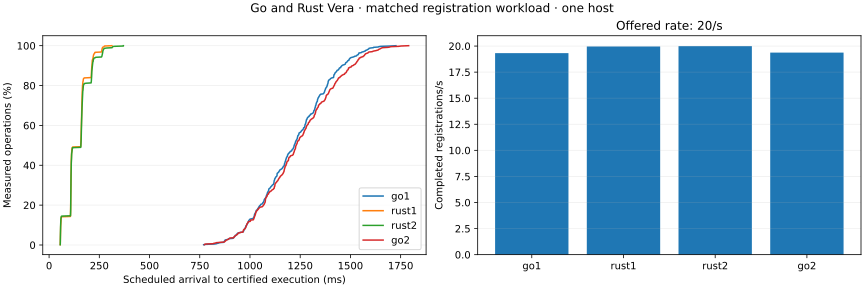

# Go/Rust and allocator measurements on October 11, 2026

These measurements use four validators and a client on one hosted Linux machine.
They establish observed behavior at the offered load. Receipt latency includes
submission, finalization and client verification; it is not consensus-only latency.

## Matched Go/Rust registrations

[Run 38146229649](https://github.com/sourcenetwork/vera.rs/actions/runs/38146229649)
ran fresh Go, Rust, Rust and Go deployments in that order on the same four-CPU
AMD EPYC host. Each pass registered 600 distinct objects using 600 signing actors,
at 20 offered registrations/s, with 128 outstanding requests allowed and no
permission reads in the timed workflow. All 2,400 registrations completed.
Four-replica reconciliation and each implementation's restart checks passed.

| Pass | Completed registrations/s | Receipt p50 / p95 / p99 (ms) |
| --- | ---: | ---: |
| Go first | 19.317 | 1220.083 / 1531.290 / 1614.479 |
| Rust first | 19.957 | 158.110 / 220.956 / 265.552 |
| Rust second | 19.989 | 158.300 / 263.688 / 313.655 |
| Go second | 19.369 | 1229.392 / 1568.898 / 1660.345 |

The median of the two receipt p95 values is 1,550.094 ms for Go and 242.322 ms
for Rust. The observed ratio is 6.40, with different protocols, signing schemes,
stores and timing settings. Go execution results require verification against the
next signed header; Rust uses its native certified receipt. Go uses GoLevelDB and
a 200 ms commit timeout. Rust uses Regolith, a 100 ms proposal batch wait and
pipelined Simplex with four optimistic views and 16-view leader terms. This is an
end-to-end comparison of these deployments, not an isolated algorithm speedup.

Go source is historical reference `ce83826bfeb4ce0fdc1751fc6a28cd4b9c7e7933`,
not a claim about its latest release. Rust source is
`44907d84a540da626e52e399ecc7e638800f6899`; its normal daemon executable matches
the independently reproduced `9d5c2b9` release binary. The artifact contains
manifests, all observations, source and binary hashes, public Go genesis and
execution evidence, verification-case records and the plotted data. Both Go
passes record all 14 execution-proof validity cases, including forged results,
signatures, headers and transaction proofs. Go owner queries establish replica
consistency, not authenticated owner-state proofs. Go restarts all four nodes;
Rust restarts and inspects one recovered replica. Two short passes per service do
not establish statistical confidence, maximum capacity, steady-state memory or
WAN behavior. Resource sampling differs, so this run does not compare RSS.

## Default versus two glibc arenas

[Run 38141913834](https://github.com/sourcenetwork/vera.rs/actions/runs/38141913834)
ran two fresh deployments sequentially on one four-CPU Intel Xeon host, first with
the glibc 2.39 default and then with `MALLOC_ARENA_MAX=2`. Both used the same
normal daemon and workload binaries from
`9d5c2b9ea7cb971a7871028b7b0b22d488a7ecbf`, Regolith and consensus settings.
Each pass offered 90,000 archive/unarchive updates over 128 objects at 50/s for
30 minutes, with one certified permission read per update. All 180,000 workflows
completed; four-replica reconciliation and hard-restart inspection passed with
zero receipt or state mismatches. Heap and syscall tracing were disabled;
one-second resource sampling and periodic numeric diagnostics were enabled.

| Measurement | Default arenas | Two arenas |
| --- | ---: | ---: |
| Completed workflows/s | 49.997 | 49.997 |
| Receipt p50 / p95 / p99 (ms) | 166.781 / 282.310 / 299.672 | 166.164 / 283.076 / 301.211 |
| Verified permission read p95 (ms) | 10.482 | 10.664 |
| Last and peak workload RSS per validator (MiB) | 525.88–552.84 | 426.12–435.56 |
| Per-validator RSS growth during minutes 20–30 (MiB) | 47.04–87.83 | 29.37–40.02 |

Average final validator RSS was about 20% lower with two arenas in this pair.
Receipt p95 differed by less than one millisecond. Allocator free/reserved
counters were lower while history cache and arena-pool counters were similar,
which supports allocator retention as a contributor. These overlapping counters
do not attribute every RSS byte or prove a leak's cause. Memory continued growing
in both deployments, so the steady-state memory gate remains open. One sequential
pair does not justify a production default or establish repeatability. The
production allocator setting is unchanged. Numeric diagnostic recording includes
setup and final checks; its clock differs from the timed workload clock. Reports,
raw observations, memory plots and interactive replays are retained in the run's
artifact. Maximum throughput and physical-device write amplification were not
measured.
