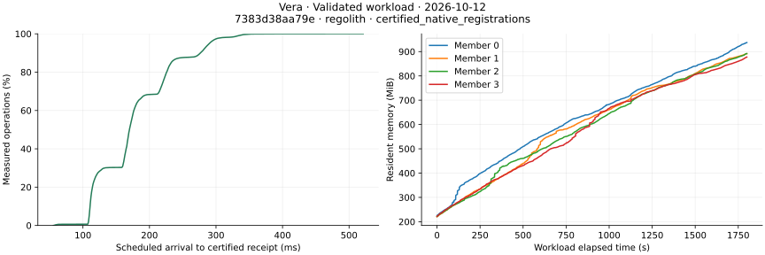

# Go/Rust and allocator measurements on October 11, 2026

These measurements use four validators and a client on one hosted Linux machine.
They establish observed behavior at the offered load. Receipt latency includes
submission, finalization and client verification; it is not consensus-only latency.

## Matched Go/Rust registrations

[Run 38146229649](https://github.com/sourcenetwork/vera.rs/actions/runs/38146229649)
ran fresh Go, Rust, Rust and Go deployments in that order on the same four-CPU
AMD EPYC host. Each pass registered 600 distinct objects using 600 signing actors,
at 20 offered registrations/s, with 128 outstanding requests allowed and no
permission reads in the timed workflow. All 2,400 registrations completed.
Four-replica reconciliation and each implementation's restart checks passed.

| Pass | Completed registrations/s | Receipt p50 / p95 / p99 (ms) |
| --- | ---: | ---: |
| Go first | 19.317 | 1220.083 / 1531.290 / 1614.479 |
| Rust first | 19.957 | 158.110 / 220.956 / 265.552 |
| Rust second | 19.989 | 158.300 / 263.688 / 313.655 |
| Go second | 19.369 | 1229.392 / 1568.898 / 1660.345 |

The median of the two receipt p95 values is 1,550.094 ms for Go and 242.322 ms
for Rust. The observed ratio is 6.40, with different protocols, signing schemes,
stores and timing settings. Go execution results require verification against the
next signed header; Rust uses its native certified receipt. Go uses GoLevelDB and
a 200 ms commit timeout. Rust uses Regolith, a 100 ms proposal batch wait and
pipelined Simplex with four optimistic views and 16-view leader terms. This is an
end-to-end comparison of these deployments, not an isolated algorithm speedup.

Go source is historical reference `ce83826bfeb4ce0fdc1751fc6a28cd4b9c7e7933`,
not a claim about its latest release. Rust source is
`44907d84a540da626e52e399ecc7e638800f6899`; its normal daemon executable matches
the independently reproduced `9d5c2b9` release binary. The artifact contains
manifests, all observations, source and binary hashes, public Go genesis and
execution evidence, verification-case records and the plotted data. Both Go
passes record all 14 execution-proof validity cases, including forged results,
signatures, headers and transaction proofs. Go owner queries establish replica
consistency, not authenticated owner-state proofs. Go restarts all four nodes;
Rust restarts and inspects one recovered replica. Two short passes per service do
not establish statistical confidence, maximum capacity, steady-state memory or
WAN behavior. Resource sampling differs, so this run does not compare RSS.

## Default versus two glibc arenas

[Run 38141913834](https://github.com/sourcenetwork/vera.rs/actions/runs/38141913834)
ran two fresh deployments sequentially on one four-CPU Intel Xeon host, first with
the glibc 2.39 default and then with `MALLOC_ARENA_MAX=2`. Both used the same
normal daemon and workload binaries from
`9d5c2b9ea7cb971a7871028b7b0b22d488a7ecbf`, Regolith and consensus settings.
Each pass offered 90,000 archive/unarchive updates over 128 objects at 50/s for
30 minutes, with one certified permission read per update. All 180,000 workflows
completed; four-replica reconciliation and hard-restart inspection passed with
zero receipt or state mismatches. Heap and syscall tracing were disabled;
one-second resource sampling and periodic numeric diagnostics were enabled.
The recorded `vera_diagnostics=debug` setting also enabled per-revision diagnostic
logging. This is an instrumented allocator comparison; it does not qualify the
same improvement without that logging overhead.

| Measurement | Default arenas | Two arenas |
| --- | ---: | ---: |
| Completed workflows/s | 49.997 | 49.997 |
| Receipt p50 / p95 / p99 (ms) | 166.781 / 282.310 / 299.672 | 166.164 / 283.076 / 301.211 |
| Verified permission read p95 (ms) | 10.482 | 10.664 |
| Last and peak workload RSS per validator (MiB) | 525.88–552.84 | 426.12–435.56 |
| Per-validator RSS growth during minutes 20–30 (MiB) | 47.04–87.83 | 29.37–40.02 |

Average final validator RSS was about 20% lower with two arenas in this pair.
Receipt p95 differed by less than one millisecond. Allocator free/reserved
counters were lower while history cache and arena-pool counters were similar,
which supports allocator retention as a contributor. These overlapping counters
do not attribute every RSS byte or prove a leak's cause. Memory continued growing
in both deployments, so the steady-state memory gate remains open. One sequential
pair does not justify a production default or establish repeatability. The
production allocator setting is unchanged. Numeric diagnostic recording includes
setup and final checks; its clock differs from the timed workload clock. Reports,
raw observations, memory plots and interactive replays are retained in the run's
artifact. Maximum throughput and physical-device write amplification were not
measured.

## Sustained mixed policies

[Run 38146872656](https://github.com/sourcenetwork/vera.rs/actions/runs/38146872656)
completed 2,048 graph workflows at one offered workflow/s over 2,048.285 seconds
(34.14 minutes). Each workflow registers four objects and exercises recursive
groups, intersections, exclusions, revocation and regrant. Four validators ran on
one hosted Linux machine with the normal release daemon and no heap or syscall
tracing. The measured completion rate was 0.999861 workflows/s.

| Measurement | Observed value |
| --- | ---: |
| Timed workflow p50 / p95 / p99 (ms) | 974.918 / 1335.613 / 1409.189 |
| Scheduled arrival to workflow completion p95 (ms) | 1337.343 |
| Certified submission p50 / p95 / p99 across the full fixture (ms) | 109.846 / 220.429 / 314.244 |
| Certified native submissions across the full fixture | 12,291 |
| Certified embedded mutations across the full fixture | 34,819 |
| Verified permission / owner checks across the full fixture | 614,400 / 163,840 |
| Throttled requests | 0 |
| Final timed-workload RSS per validator (MiB) | 502.44–518.61 |
| Peak timed-workload RSS per validator (MiB) | 504.34–520.36 |

All four replicas passed reconciliation after the timed load, relation removal,
relation reintroduction, explicit regrant and hard restart. Definition edits occur
after the timed load. Native submission and mutation totals include setup and
these later phases; they are not timed throughput counts. The reported restart
interval is 436.105 seconds and includes readiness plus complete reconciliation
of every workflow on all four replicas. It does not measure service startup alone.

The artifact retains 2,049 complete four-member RSS samples and all 12 storage
phase/member records. RSS increased by 44.39–62.42 MiB per validator during the
last ten measured minutes while graph state was growing. This run does not
establish a fixed-state memory plateau, maximum capacity, overload behavior,
continuous policy-definition changes, validator membership churn or WAN behavior.

Source is `8e5c0dee06d920259122125cd49dc1ffbe97e4d8`; the reported normal daemon
and workload hashes match the qualified release and smaller mixed-policy case.
The retained artifact is `sustained-mixed-policy-evidence`, ZIP SHA-256
`4bf2d857a535cbb6a77dd9ae1df743c2c4495a9fc500d0d2205433f35e6f132b`.
It contains validated aggregates and the RSS series. Individual operation timings
and machine manifests were not exported, so the percentiles cannot be independently
recomputed from this artifact. The bounded source verifier checked every operation
before exporting the aggregates.

## Two-hour fixed-object run with an unresolved final check

[Run 38152181596](https://github.com/sourcenetwork/vera.rs/actions/runs/38152181596)
offered 360,000 archive/unarchive updates over 128 objects at 50/s, with one
certified permission check per update. All workflows completed over 7,200.243
seconds; subsequent receipt reconciliation verified all 360,000 outcomes across
four replicas with zero unresolved results. The runner then exited with status
101 before emitting its recovery result. Its artifact excluded stderr, so the
exact failing state or recovery check is unknown. This run is a failed
qualification, despite the completed workload and receipt reconciliation.

| Measurement during the timed workload | Observed value |
| --- | ---: |
| Completed workflows/s | 49.998 |
| Scheduled arrival to certified receipt p50 / p95 / p99 (ms) | 168.986 / 287.876 / 321.578 |
| Scheduled arrival to completed workflow p50 / p95 / p99 (ms) | 172.743 / 294.805 / 329.600 |
| Certified permission read p95 (ms) | 11.382 |
| Final validator RSS (MiB) | 769.98–774.07 |
| Per-validator RSS growth during the final ten minutes (MiB) | 0.09–3.06 |

Each validator supplied 7,201 complete one-second workload RSS samples. Numeric
node snapshots continue through the later checks and use a different clock.
The normal daemon SHA-256 is
`05c6aa09252762130d135fbdc187ccdc71e186e8095362cd5688ac5e913da7e1`;
the runner source is `e161dd3b4702de41207e64c43baa0a13bb0b6e45`.
The run used glibc 2.39 with two arenas on a four-CPU AMD EPYC host.
`vera_diagnostics=debug` enabled per-revision events as well as resource snapshots.
The measurements therefore do not establish behavior without that logging,
successful restart, a stable memory bound, maximum capacity or WAN performance.
## Growing state on merged main — October 12, 2026

[Run 38220052997](https://github.com/sourcenetwork/vera.rs/actions/runs/38220052997)
used source `7383d38aa79ec8c1f970ef685aae6479a7c9e4e9`, Rust 1.98.0 release
builds, four validators on one Ubuntu 24.04 hosted machine (AMD EPYC 7763,
four logical CPUs and 15.61 GiB visible RAM), Regolith history,
and the default glibc allocator without an arena override. It offered 90,000
distinct signed ACP registrations at 50/s over 30 minutes. Permission checks
followed each verified receipt. All 90,000 operations reconciled across four
replicas; the restarted validator retained every inspected receipt and owner.

The measured daemon's SHA-256 matches the normal native Linux release artifact
from [main CI 38218777647](https://github.com/sourcenetwork/vera.rs/actions/runs/38218777647).

| Measurement | Observed result |
| --- | ---: |
| Completed operations | 90,000 / 90,000 |
| Completed operations/s, including drain | 49.997 |
| Certified receipt latency p50 / p95 / p99 | 169.88 / 290.16 / 333.50 ms |
| Permission-read latency p95 | 10.31 ms |
| Restart to valid RPC readiness | 8.63 s |
| Peak sampled RSS per validator (`ps`) | 877.48–937.33 MiB |
| Mean process CPU use per validator | 0.41–0.45 cores |
| RSS change during the final observed ten-minute window | +151.28–185.44 MiB |
| Missing validator resource samples | 0 |

The live object and signer dataset grows throughout this workload. These results
qualify the recorded growing-state case and its restart, rather than a constant
memory plateau or maximum capacity. `ps` RSS and Linux `/proc` status components
are separate, non-atomic samples. CPU cores are cumulative process CPU-seconds
divided by the observed wall-clock interval. Backend counters include later
verification time and must not be added to timed RSS or allocator counters.
Resource snapshots run every 30 seconds; per-revision diagnostics and span-close
tracing were disabled. No zero-overhead or WAN claim follows.

Raw observations, manifests, backend counters, plots and an offline HTML replay
are in the workflow artifact. All recorded outcomes, latency percentiles and
resource coverage were checked against the raw data. The plot uses the timed
receipt and `ps` RSS samples:

